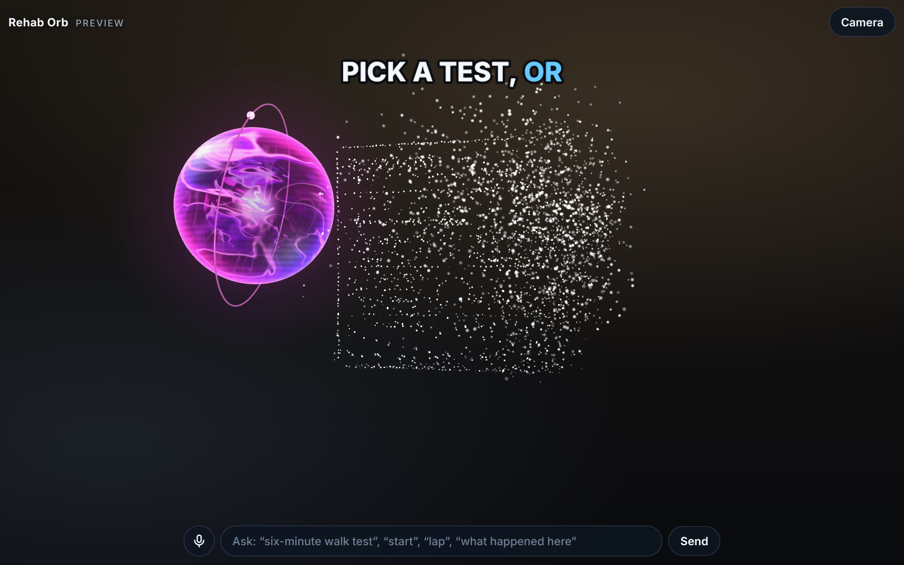
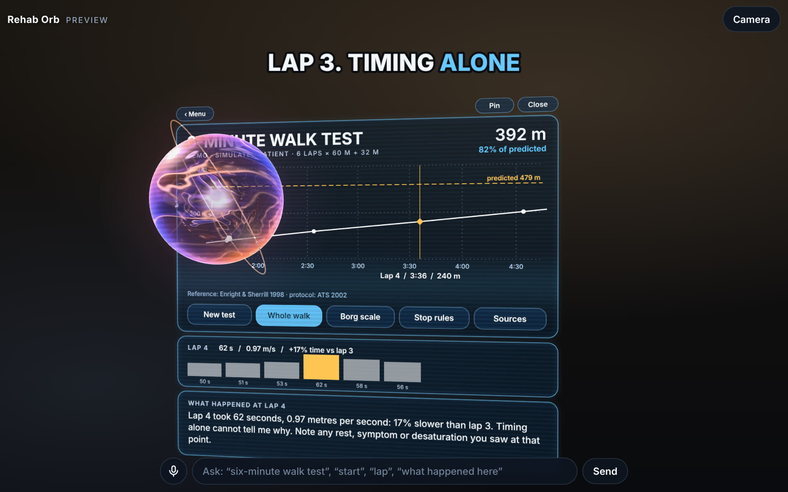

# Rehab Orb

Un assistente in realtà aumentata per chi fa riabilitazione. È una sfera luminosa che resta accanto a te durante un test clinico: tiene il tempo, dice le frasi standard, conta, e alla fine mostra il risultato come un grafico appeso nella stanza, che puoi puntare per farti spiegare un punto preciso.

Nasce dall'analisi di un reel di riferimento ([docs/REEL-ANALYSIS.md](docs/REEL-ANALYSIS.md)) e riusa i contenuti clinici, già verificati, di tre reel di `short-film-test`.

Interfaccia, voce e contenuti sono in **inglese**.



## Sfera e display

Sono due oggetti con due comportamenti diversi, come nel reel.

- **All'avvio c'è solo la sfera.** Segue la telecamera in modo evidente: quando ti giri resta indietro nella stanza, poi ti raggiunge scivolando e si assesta con un piccolo rimbalzo, in circa un secondo. Non sta mai del tutto ferma, e in una rotazione veloce il bordo dello schermo la trascina, così non esce dall'inquadratura. Può passare davanti al display.
- **La sfera è un volume.** Ha un guscio esterno di nastri luminosi illuminato dall'alto a sinistra, con il bordo acceso e due riflessi; attraverso il guscio si vedono il suo lato lontano, un guscio interno che gira al contrario e un nucleo luminoso. Un anello sottile con una perla le orbita intorno, passando davanti e dietro.
- **Sfera e display sono ologrammi.** Sono fatti di luce e ci si vede attraverso: il display ha un fondo semitrasparente, il bordo luminoso, righe di scansione sottili, una fascia di luce che lo attraversa ogni tanto e un leggero tremolio. I testi hanno una propria ombra per restare leggibili anche su uno sfondo chiaro.
- **Il display si evoca con un tap.** Compare nel punto esatto che tocchi: le particelle escono dalla sfera, ne disegnano bordi, testi e grafico, e poi la scheda diventa solida. Lo stesso succede se chiedi un test a voce: in quel caso compare davanti a te.
- **Il display resta dov'è.** È ancorato nella stanza, leggermente ruotato verso di te, e oscilla di pochi millimetri su e giù. Un tap su un punto vuoto lo sposta lì; con **Pin** i tap non lo spostano più. **Close** lo fa rientrare nella sfera.
- Se la sfera copre un pulsante, il tap va comunque al pulsante.



## Esperimento: la vetrata come display

> Solo su questo branch (`claude/window-display-bf1lo4`). È una prova, non ancora pronta per l'uso.

Tocchi una vetrata e la vetrata diventa il display.

1. Scegli **Camera view** (telefono) oppure **Use a photo of the room** (per provarlo al computer con una foto della stanza).
2. Tocca il vetro. L'app cerca la vetrata nell'immagine e ne propone il contorno, con quattro angoli che puoi trascinare.
3. **Use this window**: la sfera si riversa nel vetro e scompare, la stanza si attenua, il display occupa la vetrata. Il bordo dello schermo prende il colore dello stato (ascolto, lavoro, parola), al posto della sfera. I sottotitoli stanno in una fascia in basso.
4. **Close** restituisce la stanza e la sfera. **Float here instead** apre invece il display flottante di sempre.

Come funziona:
- **Riconoscimento.** Di giorno una vetrata vista da dentro è un quadrilatero luminoso in una stanza più scura. L'app parte dalla zona chiara sotto il tocco, segue verso l'alto e verso il basso i due bordi laterali del vetro, e si ferma dove trova il bordo orizzontale che va da un lato all'altro.
- **Inseguimento.** I quattro angoli sono direzioni nella stanza, quindi tengono mentre ruoti il telefono. Circa 14 volte al secondo l'immagine della fotocamera li riporta sui bordi del vetro, e questo assorbe i piccoli spostamenti e la deriva del giroscopio.
- **Riservatezza.** L'immagine della fotocamera è analizzata sul dispositivo, a bassa risoluzione, e non viene salvata né inviata.

Cosa è stato verificato:
- due foto reali della stessa vetrata, da due punti diversi: riconoscimento dell'intera vetrata in entrambe, e riaggancio automatico passando dall'una all'altra;
- 9 test automatici su una stanza sintetica (riconoscimento, falsi positivi, inseguimento, lato fuori inquadratura);
- il percorso completo nel browser, in orizzontale e in verticale, usando una foto.

Cosa **non** è stato verificato o non c'è ancora:
- **la fotocamera dal vivo**: movimento reale, esposizione che cambia, messa a fuoco. È il punto più incerto;
- **di sera**, con il vetro più scuro della stanza. C'è il caso previsto nel codice, ma non l'ho potuto provare;
- **in modalità AR (WebXR)** la funzione non è attiva: lì il browser non dà accesso ai pixel della fotocamera. Per ora vale solo in Camera view;
- i bordi alto e basso sono i meno affidabili: se non sono netti (due ante con telai diversi, una tenda), lo schermo li tiene fermi rispetto ai lati invece di inseguirli;
- camminare per la stanza: l'inseguimento regge piccoli spostamenti, non un cambio di punto di vista ampio.

## I tre argomenti

| Argomento | Cosa fa la sfera | Cosa puoi puntare |
|---|---|---|
| **6-Minute Walk Test** | Cronometro di 6 minuti, frase standard a ogni minuto, conteggio dei giri, metri dell'ultimo tratto, distanza e percentuale del predetto (Enright & Sherrill 1998) | Il percorso, i coni, i segni ogni 3 m, ogni minuto (per sentire la frase), ogni giro del grafico finale (zoom + «what happened at lap N») |
| **30-Second Chair Stand** | Cronometro di 30 secondi, conteggio delle alzate, regola del «più di metà», confronto con i cut-off CDC STEADI per età e sesso | Le fasce d'età del grafico dei cut-off, le voci della preparazione |
| **Modified Borg Scale** | Registra dispnea e fatica alle gambe, prima e dopo lo sforzo, e calcola la differenza | I livelli della scala (è il paziente che punta), le note su variazione significativa e scala 6–20 |

Ogni affermazione clinica è in [FACTS.md](FACTS.md) con la sua fonte, e lì è segnato che cosa è stato verificato solo su fonti secondarie.

## Provarla

```bash
npm install
npm run dev        # poi apri l'indirizzo che compare
```

Sullo schermo iniziale scegli come usarla:

| Modo | Dove funziona | Come si punta |
|---|---|---|
| **Enter AR** | Browser del Meta Quest; Chrome su Android con ARCore. Serve HTTPS. | Raggio del controller o della mano; sul telefono, un tocco |
| **Camera view** | Qualsiasi telefono, anche senza WebXR (per esempio iPhone): fotocamera posteriore come sfondo e giroscopio per guardarsi intorno | Tocco |
| **Use a photo of the room** | Qualsiasi browser: una foto al posto della fotocamera | Mouse o tocco |
| **Preview on this screen** | Qualsiasi browser recente | Mouse o tocco. Trascina per guardarti intorno, rotella o due dita per lo zoom |

Per provarla su un visore o un telefono la pagina deve essere pubblicata su HTTPS: `npm run build` produce la cartella `dist/`, statica, che si può mettere su qualunque hosting.

### Cosa dire (o scrivere nella casella in basso)

- `six-minute walk test` · `chair stand` · `Borg scale` · `menu` · `close`
- `the patient is a man, 72 years, 170 cm, 78 kg`
- `start` · `demo` · `lap` · `stop` · `32 metres` · `new test`
- `stop rules` · `sources` · `what should I say` · `what does this mean`
- puntando un giro: `right here` · `what happened here`
- `pin` (i tap non spostano più il display) · `come here` (il display torna davanti a te) · `mute`

Tutti i comandi hanno anche un pulsante sulla scheda, quindi l'app si usa per intero anche senza voce. La barra spaziatrice vale «+1 giro» o «+1 alzata» durante un test.

`Demo` fa partire un paziente simulato, dichiarato a schermo: serve a vedere tutto il percorso in mezzo minuto e a registrare un video dimostrativo.

## Cosa è stato verificato e cosa no

Verificato in questa sessione:
- 14 test automatici (`npm test`) su equazioni, cut-off, frasi al minuto, comandi vocali, regole di sicurezza;
- l'app intera in Chromium, in orizzontale e in verticale, con il mouse su ogni tipo di bersaglio;
- la modalità AR con un **emulatore** di Quest 3 (sessione WebXR, display evocato nel punto indicato dal raggio, display fermo e sfera che segue quando ci si gira e ci si sposta);
- un telefono emulato in verticale, con il tocco.

**Non verificato**, perché qui non c'era l'hardware:
- un visore vero e un telefono vero, quindi leggibilità, comfort e prestazioni reali;
- la voce: il riconoscimento e la sintesi vocale del browser non esistono nel browser di prova. Sul browser del Quest il riconoscimento vocale molto probabilmente manca: lì l'app si usa puntando, e la sfera risponde con i sottotitoli;
- il tracciamento delle mani e la modalità fotocamera con giroscopio.

Limiti da conoscere:
- il «cervello» riconosce frasi previste, non conversa liberamente come nel reel. È una scelta: ogni frase clinica è scritta, ha una fonte e si può rivedere. `src/brain/Brain.js` è il solo punto da sostituire per collegare un modello linguistico;
- sullo schermo di un telefono, fuori dall'AR, la scheda è piccola;
- i dati del paziente restano in memoria e spariscono alla chiusura della pagina. Niente viene salvato o inviato;
- è un supporto per professionisti formati. Non è un dispositivo medico e non è stata validata clinicamente.

## Com'è fatta

```
src/
  main.js              avvio, modi (AR / camera / preview), ciclo principale
  scene/Stage.js       scena three.js: la sfera che segue la telecamera, il display ancorato, puntamento
  scene/Orb.js         la sfera (shader) e i suoi colori di stato
  scene/Panel.js       la scheda ancorata nella stanza (due livelli: cornice + dato)
  scene/Particles.js   lo sciame che porta il dato dalla sfera alla scheda
  scene/Caption.js     sottotitoli a karaoke dentro la scena
  input/Pointer.js     controller, mano, tocco e mouse come un unico raggio
  vision/              (esperimento) riconoscere e inseguire una vetrata nell'immagine della fotocamera
  scene/WindowScreen.js  (esperimento) lo schermo che prende il posto della vetrata
  voice/Voice.js       sintesi e riconoscimento vocale del browser
  brain/Brain.js       da parole e puntamento ad azioni
  topics/              un file per argomento + clinical.js (numeri e formule)
  ui/kit.js            il disegno delle schede (testi, pulsanti, grafici)
tests/                 test della logica clinica e del cervello
```

Per aggiungere un argomento: un file in `src/topics/` con `enter`, `press`, `hear`, `tick`, `height`, `draw`; una riga in `Brain.js` (`TOPIC_PATTERNS` e `topics`); una tessera in `home.js`; le sue righe in `FACTS.md`.

Il parametro `?speed=N` accelera i cronometri: serve solo per le prove, non per l'uso clinico.

Licenze e materiali di terzi: [CREDITS](CREDITS).
