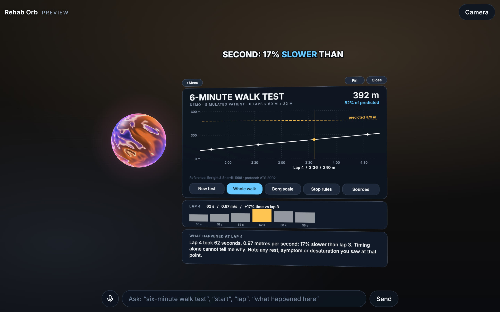

# Rehab Orb

Un assistente in realtà aumentata per chi fa riabilitazione. È una sfera luminosa che resta accanto a te durante un test clinico: tiene il tempo, dice le frasi standard, conta, e alla fine mostra il risultato come un grafico appeso nella stanza, che puoi puntare per farti spiegare un punto preciso.

Nasce dall'analisi di un reel di riferimento ([docs/REEL-ANALYSIS.md](docs/REEL-ANALYSIS.md)) e riusa i contenuti clinici, già verificati, di tre reel di `short-film-test`.

Interfaccia, voce e contenuti sono in **inglese**.



## I tre argomenti

| Argomento | Cosa fa la sfera | Cosa puoi puntare |
|---|---|---|
| **6-Minute Walk Test** | Cronometro di 6 minuti, frase standard a ogni minuto, conteggio dei giri, metri dell'ultimo tratto, distanza e percentuale del predetto (Enright & Sherrill 1998) | Il percorso, i coni, i segni ogni 3 m, ogni minuto (per sentire la frase), ogni giro del grafico finale (zoom + «what happened at lap N») |
| **30-Second Chair Stand** | Cronometro di 30 secondi, conteggio delle alzate, regola del «più di metà», confronto con i cut-off CDC STEADI per età e sesso | Le fasce d'età del grafico dei cut-off, le voci della preparazione |
| **Modified Borg Scale** | Registra dispnea e fatica alle gambe, prima e dopo lo sforzo, e calcola la differenza | I livelli della scala (è il paziente che punta), le note su variazione significativa e scala 6–20 |

Ogni affermazione clinica è in [FACTS.md](FACTS.md) con la sua fonte, e lì è segnato che cosa è stato verificato solo su fonti secondarie.

## Provarla

```bash
npm install
npm run dev        # poi apri l'indirizzo che compare
```

Sullo schermo iniziale scegli come usarla:

| Modo | Dove funziona | Come si punta |
|---|---|---|
| **Enter AR** | Browser del Meta Quest; Chrome su Android con ARCore. Serve HTTPS. | Raggio del controller o della mano; sul telefono, un tocco |
| **Camera view** | Telefoni senza WebXR (per esempio iPhone): fotocamera posteriore come sfondo e giroscopio per guardarsi intorno | Tocco |
| **Preview on this screen** | Qualsiasi browser recente | Mouse o tocco |

Per provarla su un visore o un telefono la pagina deve essere pubblicata su HTTPS: `npm run build` produce la cartella `dist/`, statica, che si può mettere su qualunque hosting.

### Cosa dire (o scrivere nella casella in basso)

- `six-minute walk test` · `chair stand` · `Borg scale` · `menu` · `close`
- `the patient is a man, 72 years, 170 cm, 78 kg`
- `start` · `demo` · `lap` · `stop` · `32 metres` · `new test`
- `stop rules` · `sources` · `what should I say` · `what does this mean`
- puntando un giro: `right here` · `what happened here`
- `pin` (resta ferma dove l'hai messa) · `come here` · `mute`

Tutti i comandi hanno anche un pulsante sulla scheda, quindi l'app si usa per intero anche senza voce. La barra spaziatrice vale «+1 giro» o «+1 alzata» durante un test.

`Demo` fa partire un paziente simulato, dichiarato a schermo: serve a vedere tutto il percorso in mezzo minuto e a registrare un video dimostrativo.

## Cosa è stato verificato e cosa no

Verificato in questa sessione:
- 14 test automatici (`npm test`) su equazioni, cut-off, frasi al minuto, comandi vocali, regole di sicurezza;
- l'app intera in Chromium, in orizzontale e in verticale, con il mouse su ogni tipo di bersaglio;
- la modalità AR con un **emulatore** di Quest 3 (sessione WebXR, posizionamento nella stanza, raggio del controller, grilletto, riposizionamento quando ci si gira).

**Non verificato**, perché qui non c'era l'hardware:
- un visore vero e un telefono vero, quindi leggibilità, comfort e prestazioni reali;
- la voce: il riconoscimento e la sintesi vocale del browser non esistono nel browser di prova. Sul browser del Quest il riconoscimento vocale molto probabilmente manca: lì l'app si usa puntando, e la sfera risponde con i sottotitoli;
- il tracciamento delle mani e la modalità fotocamera con giroscopio.

Limiti da conoscere:
- il «cervello» riconosce frasi previste, non conversa liberamente come nel reel. È una scelta: ogni frase clinica è scritta, ha una fonte e si può rivedere. `src/brain/Brain.js` è il solo punto da sostituire per collegare un modello linguistico;
- sullo schermo di un telefono, fuori dall'AR, la scheda è piccola;
- i dati del paziente restano in memoria e spariscono alla chiusura della pagina. Niente viene salvato o inviato;
- è un supporto per professionisti formati. Non è un dispositivo medico e non è stata validata clinicamente.

## Com'è fatta

```
src/
  main.js              avvio, modi (AR / camera / preview), ciclo principale
  scene/Stage.js       scena three.js: dove stanno sfera e scheda, puntamento
  scene/Orb.js         la sfera (shader) e i suoi colori di stato
  scene/Panel.js       la scheda ancorata nella stanza (due livelli: cornice + dato)
  scene/Particles.js   lo sciame che porta il dato dalla sfera alla scheda
  scene/Caption.js     sottotitoli a karaoke dentro la scena
  input/Pointer.js     controller, mano, tocco e mouse come un unico raggio
  voice/Voice.js       sintesi e riconoscimento vocale del browser
  brain/Brain.js       da parole e puntamento ad azioni
  topics/              un file per argomento + clinical.js (numeri e formule)
  ui/kit.js            il disegno delle schede (testi, pulsanti, grafici)
tests/                 test della logica clinica e del cervello
```

Per aggiungere un argomento: un file in `src/topics/` con `enter`, `press`, `hear`, `tick`, `height`, `draw`; una riga in `Brain.js` (`TOPIC_PATTERNS` e `topics`); una tessera in `home.js`; le sue righe in `FACTS.md`.

Il parametro `?speed=N` accelera i cronometri: serve solo per le prove, non per l'uso clinico.

Licenze e materiali di terzi: [CREDITS](CREDITS).
