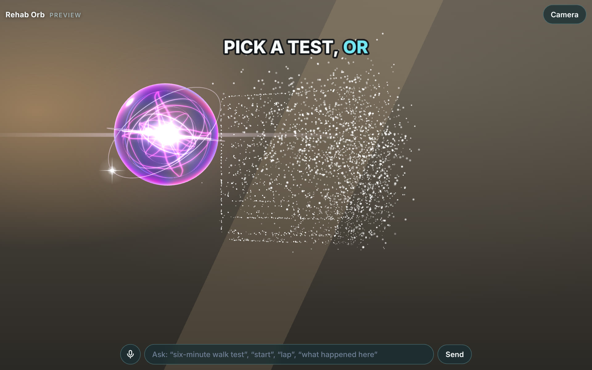
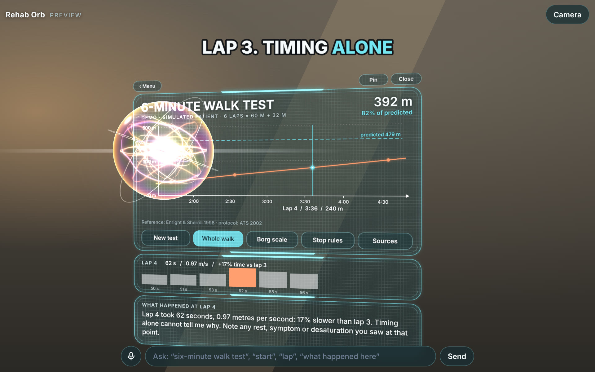

# Rehab Orb

Un assistente in realtà aumentata per chi fa riabilitazione. È una sfera luminosa che resta accanto a te durante un test clinico: tiene il tempo, dice le frasi standard, conta, e alla fine mostra il risultato come un grafico appeso nella stanza, che puoi puntare per farti spiegare un punto preciso.

Nasce dall'analisi di un reel di riferimento ([docs/REEL-ANALYSIS.md](docs/REEL-ANALYSIS.md)) e riusa i contenuti clinici, già verificati, di tre reel di `short-film-test`.

Interfaccia, voce e contenuti sono in **inglese**.



## Sfera e display

Sono due oggetti con due comportamenti diversi, come nel reel. L'aspetto segue il concept video dell'owner (`rehab-orb-concept.mp4`), che non è nella repo.

- **All'avvio c'è solo la sfera, e ti segue.** Quando ti giri resta indietro nella stanza, poi ti raggiunge scivolando e si assesta con un piccolo rimbalzo. Non sta mai del tutto ferma, e in una rotazione veloce il bordo dello schermo la trascina, così non esce dall'inquadratura.
- **La sfera è una bolla di vetro**, disegnata sul concept video: una pellicola iridescente che passa dal rosa al verde acqua al lilla verso il bordo, un nucleo bianco luminoso, sottili filamenti di luce avvolti attorno al centro, due orbite inclinate con una piccola stella ciascuna e un riflesso orizzontale da obiettivo. Aggiunge solo luce: non scurisce mai quello che c'è dietro. Il colore dice lo stato: rosa e verde acqua a riposo, verde acqua quando ascolta, magenta quando lavora, pesca e lilla quando parla.
- **Il display è un vetro smerigliato**: grigio-verde e semitrasparente, con una griglia fine incisa, un doppio bordo sottile verde acqua con gli angoli arrotondati e due barre di luce ciano al centro dei lati alto e basso. Nei grafici gli assi sono bianchi con la freccia, le guide tratteggiate, i dati una linea corallo; i riferimenti (come il valore predetto) e la selezione sono in ciano. Quando compare, le particelle disegnano prima il contorno; poi il grafico si traccia da sinistra a destra. I testi hanno una propria ombra per restare leggibili anche su uno sfondo chiaro.
- **Il display si evoca con un tap.** Compare nel punto esatto che tocchi: le particelle escono dalla sfera, ne disegnano bordi, testi e grafico, e poi la scheda diventa solida. Lo stesso succede se chiedi un test a voce: in quel caso compare davanti a te.
- **Quando fissi un punto, entrambi restano lì.** Il display si ancora nel punto toccato, leggermente ruotato verso di te, e oscilla di pochi millimetri su e giù. La sfera smette di seguirti e va a posarsi alla sua sinistra, un po' più avanti, dove fluttua. Se ti sposti li vedi dalla nuova posizione, come oggetti veri nella stanza; se chiudi il display, la sfera torna a seguirti. Un tap su un punto vuoto sposta il display lì (e la sfera lo segue); con **Pin** i tap non lo spostano più. **Close** lo fa rientrare nella sfera.
- **Hanno un'ombra.** Una luce dall'alto, un po' dal lato da cui guardavi quando hai evocato il display, proietta sul pavimento le loro ombre morbide: la trama dei filamenti e gli anelli della sfera; il bordo, i testi e il grafico del display, con un velo più leggero per il vetro. Sotto la sfera c'è una pozza della sua luce colorata, sotto il display una della barra ciano. L'ombra dice all'occhio a che altezza e a che distanza sono.
- **Il display ha uno spessore.** È una lastra: il retro del vetro sta 1,6 cm dietro, il grafico fluttua 1,1 cm davanti. Girandoci intorno gli strati si separano, e da dietro si vede il contenuto in trasparenza, specchiato.
- Se la sfera copre un pulsante, il tap va comunque al pulsante.



## I tre argomenti

| Argomento | Cosa fa la sfera | Cosa puoi puntare |
|---|---|---|
| **6-Minute Walk Test** | Cronometro di 6 minuti, frase standard a ogni minuto, conteggio dei giri, metri dell'ultimo tratto, distanza e percentuale del predetto (Enright & Sherrill 1998) | Il percorso, i coni, i segni ogni 3 m, ogni minuto (per sentire la frase), ogni giro del grafico finale (zoom + «what happened at lap N») |
| **30-Second Chair Stand** | Cronometro di 30 secondi, conteggio delle alzate, regola del «più di metà», confronto con i cut-off CDC STEADI per età e sesso | Le fasce d'età del grafico dei cut-off, le voci della preparazione |
| **Modified Borg Scale** | Registra dispnea e fatica alle gambe, prima e dopo lo sforzo, e calcola la differenza | I livelli della scala (è il paziente che punta), le note su variazione significativa e scala 6–20 |

Ogni affermazione clinica è in [FACTS.md](FACTS.md) con la sua fonte, e lì è segnato che cosa è stato verificato solo su fonti secondarie.

## Provarla

```bash
npm install
npm run dev        # poi apri l'indirizzo che compare
```

Sullo schermo iniziale scegli come usarla:

| Modo | Dove funziona | Come si punta |
|---|---|---|
| **Enter AR** | Browser del Meta Quest; Chrome su Android con ARCore. Serve HTTPS. | Raggio del controller o della mano; sul telefono, un tocco |
| **Camera view** | Telefoni senza WebXR (per esempio iPhone): fotocamera posteriore come sfondo e giroscopio per guardarsi intorno | Tocco |
| **Preview on this screen** | Qualsiasi browser recente | Mouse o tocco. Trascina per guardarti intorno, rotella o due dita per lo zoom, **WASD o frecce per camminare** (c'è una griglia leggera sul pavimento per leggere le distanze) |

Per provarla su un visore o un telefono la pagina deve essere pubblicata su HTTPS: `npm run build` produce la cartella `dist/`, statica, che si può mettere su qualunque hosting.

### Dove si può girare intorno agli oggetti

- **Enter AR** (Android con Chrome, Meta Quest): sì. Il dispositivo sa dove ti trovi e dove guardi, e l'app misura l'altezza vera del pavimento appena lo inquadri.
- **Camera view** (anche iPhone): no. Il browser sa solo come ruota il telefono, non come ti sposti: gli oggetti restano fermi mentre ti guardi intorno, ma se cammini vengono con te. Il pavimento è stimato 1,35 m sotto il telefono, quindi le ombre cadono nel punto giusto se tieni il telefono all'altezza del petto. Su iPhone, Safari non offre l'AR con tracciamento della posizione (WebXR): per averla servirebbe un'app nativa.
- **Preview on this screen**: sì, camminando con WASD o le frecce.

### Prestazioni

L'app ha tre livelli di qualità. Cambia solo quanto disegna, non come funziona:

| Livello | Risoluzione | Particelle | Ombre | Sfera |
|---|---|---|---|---|
| **high** (computer) | piena (fino a 2×) | 4200 | dettagliate, a ogni fotogramma | tutti gli strati |
| **medium** (telefoni, all'avvio) | 1,5× · in AR 85% | 2600 | più leggere, un fotogramma sì e uno no | senza gli strati interni |
| **low** | 1× · in AR 70% | 1500 | solo le ombre proiettate leggere (niente mappa d'ombra) | senza gli strati interni |

Se per due secondi i fotogrammi sono troppo lenti, l'app scende di un livello da sola. Il riferimento è il ritmo del dispositivo stesso (molti telefoni in AR vanno a 30 fotogrammi al secondo per natura) oppure i 24 fotogrammi al secondo. Per fissare un livello: aggiungi `?quality=high`, `?quality=medium` o `?quality=low` all'indirizzo.

### Cosa dire (o scrivere nella casella in basso)

- `six-minute walk test` · `chair stand` · `Borg scale` · `menu` · `close`
- `the patient is a man, 72 years, 170 cm, 78 kg`
- `start` · `demo` · `lap` · `stop` · `32 metres` · `new test`
- `stop rules` · `sources` · `what should I say` · `what does this mean`
- puntando un giro: `right here` · `what happened here`
- `pin` (i tap non spostano più il display) · `come here` (il display torna davanti a te) · `mute`

Tutti i comandi hanno anche un pulsante sulla scheda, quindi l'app si usa per intero anche senza voce. La barra spaziatrice vale «+1 giro» o «+1 alzata» durante un test.

`Demo` fa partire un paziente simulato, dichiarato a schermo: serve a vedere tutto il percorso in mezzo minuto e a registrare un video dimostrativo.

## Cosa è stato verificato e cosa no

Verificato in questa sessione:
- 14 test automatici (`npm test`) su equazioni, cut-off, frasi al minuto, comandi vocali, regole di sicurezza;
- l'app intera in Chromium, in orizzontale e in verticale, con il mouse su ogni tipo di bersaglio;
- la modalità AR con un **emulatore** di Quest 3 (sessione WebXR, display evocato nel punto indicato dal raggio, display fermo e sfera che segue quando ci si gira e ci si sposta);
- un telefono emulato in verticale, con il tocco.

**Non verificato**, perché qui non c'era l'hardware:
- un visore vero e un telefono vero, quindi leggibilità, comfort e prestazioni reali;
- la voce: il riconoscimento e la sintesi vocale del browser non esistono nel browser di prova. Sul browser del Quest il riconoscimento vocale molto probabilmente manca: lì l'app si usa puntando, e la sfera risponde con i sottotitoli;
- il tracciamento delle mani e la modalità fotocamera con giroscopio.

Limiti da conoscere:
- il «cervello» riconosce frasi previste, non conversa liberamente come nel reel. È una scelta: ogni frase clinica è scritta, ha una fonte e si può rivedere. `src/brain/Brain.js` è il solo punto da sostituire per collegare un modello linguistico;
- sullo schermo di un telefono, fuori dall'AR, la scheda è piccola;
- i dati del paziente restano in memoria e spariscono alla chiusura della pagina. Niente viene salvato o inviato;
- è un supporto per professionisti formati. Non è un dispositivo medico e non è stata validata clinicamente.

## Com'è fatta

```
src/
  main.js              avvio, modi (AR / camera / preview), ciclo principale
  scene/Stage.js       scena three.js: la sfera che segue la telecamera, il display ancorato, puntamento
  scene/Orb.js         la sfera (shader) e i suoi colori di stato
  scene/Panel.js       la scheda ancorata nella stanza (due livelli: cornice + dato)
  scene/Particles.js   lo sciame che porta il dato dalla sfera alla scheda
  scene/Caption.js     sottotitoli a karaoke dentro la scena
  input/Pointer.js     controller, mano, tocco e mouse come un unico raggio
  voice/Voice.js       sintesi e riconoscimento vocale del browser
  brain/Brain.js       da parole e puntamento ad azioni
  topics/              un file per argomento + clinical.js (numeri e formule)
  ui/kit.js            il disegno delle schede (testi, pulsanti, grafici)
tests/                 test della logica clinica e del cervello
```

Per aggiungere un argomento: un file in `src/topics/` con `enter`, `press`, `hear`, `tick`, `height`, `draw`; una riga in `Brain.js` (`TOPIC_PATTERNS` e `topics`); una tessera in `home.js`; le sue righe in `FACTS.md`.

Il parametro `?speed=N` accelera i cronometri: serve solo per le prove, non per l'uso clinico.

Licenze e materiali di terzi: [CREDITS](CREDITS).
